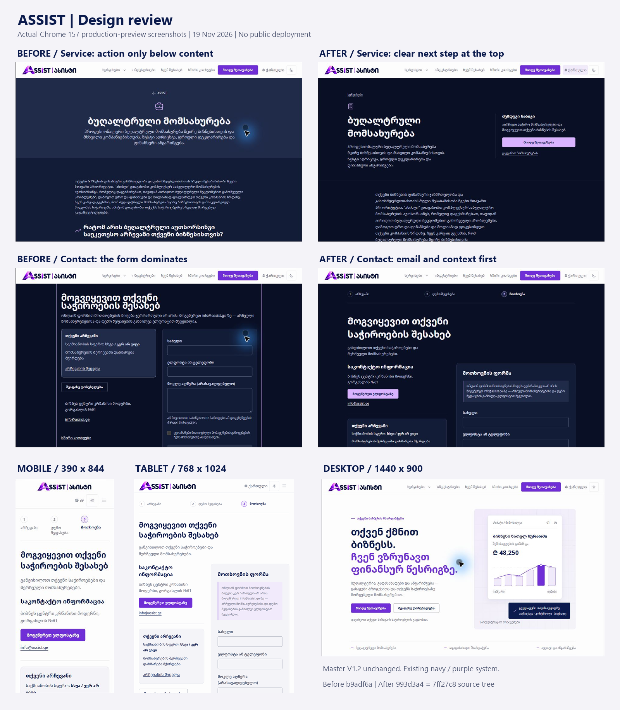

## ახალი მიმდინარე ეტაპი — დიზაინერული აუდიტი, 19 ნოემბერი 2026

**ამ დავალებაში merge/public deployment აკრძალულია.** ქვემოთ წინა გამოქვეყნების ნებართვა ისტორიულია და ამ ეტაპს არ ეხება. PR #1 უკვე გაერთიანდა; ახალი სამუშაოა [Draft PR #2](https://github.com/revaza88/assistpro/pull/2), `codex/assist-design-audit-2026-11-19`, main b9adf6a-დან. main ამ ეტაპზე არ შეცვლილა.

შემოწმებული აპლიკაცია [7ff27c8](https://github.com/revaza88/assistpro/commit/7ff27c81a6aa6730502e8901090dcc5a29ab9440), tree `3a1f7d05fbb74270ccf7a02ac6bccc0bcf9a388f`. რეალური browser993d3a4-ის მთლიანი tree ემთხვევა ამ GitHub commit-ს; canonical clean production build/HTTP audit ცალკე შესრულდა. [ახალი სრული ანგარიში](qa/2026-11-19-design-audit/README.md), [QA JSON](qa/2026-11-19-design-audit/current-run.json), [რეალური კადრების დაფა](qa/2026-11-19-design-audit/visual-board.png).

17 რეესტრის საკითხი გასწორდა: ექვსი მომსახურების ზედა მოქმედება, საერთო სათაურები/შინაარსის პროპორციები, არჩევანი→კალკულატორი→მოთხოვნა, კონტაქტის mailto პრიორიტეტი, About/Team/Career/FAQ, footer, ქართული narrow გადატანა, CSP-jitless validation და prerender CSS. Master PNG/სლოგანი/პალიტრა/ფონტები/API შენარჩუნდა. **check,35/35 ტესტი,build,smoke/audit-web/audit-release pass**. ეს ახალი ადგილობრივი შედეგებია; CI check/status0, წარმატებული CI არ დადასტურებულა.

Chrome157 production5016;320/390/768/1440 და კომპონენტების საზღვრები შერჩეულ შემთხვევებში, KA/EN/RU+თემები, კლავიატურა, scoped200%/spacing, reduced motion, რეალური Georgian font. desktop პრაქტიკული გზა2 მომსახურება+განათლება+თანამშრომლები7 მოთხოვნამდე და390-ზე შეჯამება დადასტურდა. ფორმის validation/loading/error/retry/success მხოლოდ loopback fixture-სიმულაციაა; upstream intake disabled, არც შენახვა და არც გარე გაგზავნა. preview/fixture შეჩერებულია.

დარჩენილია სრული კომბინაციური/ქვედა შინაარსის მატრიცა, ყველა control-state computed contrast, ყველა გვერდის200%/spacing, სხვა ბრაუზერები/ფიზიკური მოწყობილობა/AT, რეალური პროფილები/ფოტოები/ტელეფონი და მომხმარებლის საბოლოო ვიზუალური შეფასება. დასახელებული შერჩეული შემთხვევების განხილვა რეკომენდებულია; სრული მიღება არ გამოცხადებულა. ბაზა/intake/notifications/indexing გამორთული დარჩეს; შემდგომი მუშაობა გააგრძელეთ PR #2-ში.



---

## საჯარო გამოქვეყნება დადასტურდა — 19 ნოემბერი 2026

მომხმარებლის აშკარა თანხმობით („დიახ, გადაიტანე main-ზე“) [PR #1](https://github.com/revaza88/assistpro/pull/1) გაერთიანდა **main**-ში: [fbb86db](https://github.com/revaza88/assistpro/commit/fbb86db1b3fccc25c32c449766a3075c72929cd2). ეს ცვლის ამ დავალების წინა no-merge/no-deployment ფარგლებს. main-ის განახლებას მოჰყვა არსებული ავტომატური გამოქვეყნება **https://assist.ge**-ზე; ცალკე SSH შესვლა არ დაგვჭირდა. main-ის tree ზუსტად ემთხვევა შემოწმებულ a033a70-ს; აპლიკაციის კოდი დამატებით არ შეცვლილა.

ახალმა read-only HTTPS შემოწმებამ დაადასტურა 15 გვერდის HTTP200/ერთი H1/გამორთული intake/noindex/შესაბამისი CSP nonce; ოთხი ჩამოტვირთული საწყისი JS/CSS ფაილის ზომა და SHA-256 ზუსტად ემთხვევა შემოწმებულ build-ს. Master PNG-ის hash და ოთხივე ფონტის HTTP პასუხიც შემოწმდა. health200, არარსებული გვერდი404, robots200, გამორთული sitemap503. საჯარო POST არ გაგზავნილა. რეალური Chrome157-ში ნახულია მთავარი გვერდი KA dark390×844 და1440×900.

**გამოქვეყნება და წყაროს მეტამონაცემები გამიჯნულია:** /release.json უკვე200/no-store-ია და asset fingerprints სწორია, მაგრამ commit/tree/dirty null რჩება, რადგან ჰოსტინგის build-ს Git metadata/RELEASE_* არგუმენტები არ მიეწოდა. მკაცრი audit-release ამ მიზეზით კვლავ ვერ გადის; წარმატებად არ ჩაითვალოს. დარჩენილია build გარემოში RELEASE_COMMIT/RELEASE_TREE/RELEASE_DIRTY გადაცემა არსებული პანელის კონფიგურაციით. GitHub-ზე merge SHA-ს 0 workflow/check/status ჩანაწერი ჰქონდა; რეალური გამოქვეყნების მტკიცებულება HTTP/ფაილების შემოწმებაა, არა CI. სრული ვიზუალური მიღების ღია შემთხვევები ძალაში რჩება.

[საჯარო შემოწმების JSON](qa/2026-11-19-refinement/public-release.json) · [საჯარო მობილური კადრი](qa/2026-11-19-refinement/live-390.png) · [საჯარო desktop კადრი](qa/2026-11-19-refinement/live-1440.png). ქვემოთ არსებული „deployment დაბლოკილია/merge არ შესრულებულა“ ჩანაწერები აღწერს ამ თანხმობამდე მდგომარეობას.

---

# მიმდინარე გაგრძელება — ვიზუალური დახვეწა

Runtime **4272cc5584e2237455ed12cc58fdb3262dd7f802**, tree **ac79d6b1294b122ff26d33d29b09303c9ab7a120**. [ახალი ანგარიში](qa/2026-11-19-refinement/current-run.json) და [დაფა](qa/2026-11-19-refinement/visual-board.png). 33 ტესტი/check/build და Windows/Node24 Docker production HTTP/version audit წარმატებულია. ქვემოთ მოცემული 31-ტესტიანი ეტაპი ისტორიულია.

მომხმარებელმა მოითხოვა არსებული კავშირის აღდგენა და პროცესის დასრულება. GitHub კავშირი დადასტურდა. assist.ge ახალი რელიზი არ არის; release.json 404-ია. ამ გარემოში SSH/PuTTY პროფილი, production env ან გახსნილი ჰოსტინგის სესია ვერ მოიძებნა; Sites-ის დამოუკიდებელ მონახაზს ამ დომენთან კავშირი არ დაუდასტურდა. საჭიროა რეალური პანელის URL/არსებული SSH პროფილი, შემდეგ არსებული process manager/release directory-ის აღმოჩენა და [რელიზის გეგმის](../RELEASE.md) შესრულება. ისტორიული CloudPanel-ის private IP/account არ გამოიყენოთ რეალურ კავშირად. ბაზა/intake/გარე შეტყობინებები გამორთული დარჩეს; merge არ შესრულდეს. სერვერის რელიზი და GitHub push ცალკე სტატუსებია.

ახალი browser ფარგლები JSON-შია; სრული ვიზუალური მიღება ღიაა. შესრულებული QA თავიდან არ გაიმეოროთ მხოლოდ დოკუმენტაციის ცვლილების გამო.

---

# ASSIST 2.2 — სამუშაოს გაგრძელება Codex-ში

**განახლებულია:** 19 ნოემბერი 2026, Asia/Tbilisi  
**რეპოზიტორია:** [revaza88/assistpro](https://github.com/revaza88/assistpro)  
**განშტოება:** `codex/assist-brand-system-2-2`  
**Draft PR:** [#1 — ბრენდის 2.2 ინტეგრაცია](https://github.com/revaza88/assistpro/pull/1)

## მიმდინარე გაგრძელების მდგომარეობა — ახალი browser QA

რეალური Windows Chrome **157.0.8103.79**-ით production build შემოწმდა და გასწორდა ორი ვიზუალური ხარვეზი: 320px რუსული მომსახურების სათაურის ბოლო ასო და კალკულატორის ტიპის მოჭრილი არჩევანი. მიმდინარე runtime არის [`3ad8ad4`](https://github.com/revaza88/assistpro/commit/3ad8ad4bda7e70e41e0bf21edb4290f51a440fe5); მის tree-ს შემოწმებული ადგილობრივი `ea8ed8d` ზუსტად ემთხვევა. ახალი check/31 tests/build/smoke/audit წარმატებულია. GitHub CI ამ ეტაპზე შედეგს არ აბრუნებდა; ადგილობრივი ტესტები CI არ არის.

რეალური კადრები, [ვიზუალური დაფა](qa/2026-11-19/visual-board.png), ზუსტი შემთხვევები და დარჩენილი ფარგლები: [ახალი JSON](qa/2026-11-19/current-run.json) და [მიღების მიმდინარე ანგარიში](IMPLEMENTATION_ACCEPTANCE.md). წინა preview timeout აღარ ბლოკავს ამ ლოკალურ შემოწმებას. ბრაუზერი native CUA-ით იმართებოდა; DOM კონექტორი მიუწვდომელი იყო და კონსოლის დამცავი გაფრთხილება არ გადალახულა.

შემდეგი სამუშაოა სრული ქვედა შინაარსის/თემების/ენების მატრიცა, ყველა კონტროლის მდგომარეობის computed შემოწმება, იზოლირებული UI fixture-ით ფორმის validation/loading/error/retry (სერვერის intake-ის ჩართვის გარეშე), სრული text-spacing suite და სხვა ბრაუზერები/დამხმარე ტექნოლოგია. უკვე შესრულებული შემთხვევები ხელახლა თავიდან შესასრულებლად არ ჩათვალოთ. საბოლოო მომხმარებლის ვიზუალური შეფასება ცალკე დარჩა. ქვემოთ არსებული საწყისი გეგმა ისტორიულ კონტექსტად და ჯერ სრულად დაუფარავი კრიტერიუმების სიად იკითხება.

## მიზანი და უკვე შესრულებული სამუშაო

გააგრძელე ამ განშტოებაზე საიტის რეალურ ბრაუზერში შემოწმება და აღმოჩენილი კონკრეტული ხარვეზების გასწორება. ბრენდის წესები უკვე გადატანილია კოდში; დარჩენილია ვიზუალური მიღება და მომხმარებლის გზების პრაქტიკული შემოწმება.

წინა შემოწმებაში წარმატებით შესრულდა TypeScript, **31 ტესტი**, production build და იზოლირებული HTTP შემოწმება; გენერირდა 15 მარშრუტი და 404 გვერდი, გამოითვალა 29 განსაზღვრული ფერთა წყვილის კონტრასტი. ეს არის **ადრე შესრულებული runtime QA**, არა ამ დოკუმენტის შექმნისას ხელახლა ჩატარებული ტესტები ან GitHub CI-ის შედეგი. GitHub-ზე [runtime commit `59ad55f`](https://github.com/revaza88/assistpro/commit/59ad55f16149f158d1f7ef49fbfe213af329aa31)-ის ფაილთა ხე ზუსტად ემთხვევა შემოწმებულ ადგილობრივ `d0e24553b498ba6648b8eaee5020cf9a4bebf124`-ს. ფარგლები და მტკიცებულებები: [IMPLEMENTATION_ACCEPTANCE.md](IMPLEMENTATION_ACCEPTANCE.md), [QA_v2_2.json](QA_v2_2.json).

ჯერ წაიკითხე პროექტის [AGENTS.md](../../AGENTS.md), [BRAND_FOR_WEB.md](BRAND_FOR_WEB.md), [asset-manifest.json](asset-manifest.json), [ACCEPTANCE.md](ACCEPTANCE.md) და მიმდინარე შემოწმების ანგარიში. შეამოწმე არჩეული განშტოება და შეინარჩუნე არსებული ადგილობრივი სამუშაო.

## უცვლელი საფუძველი

- **ორიგინალი Master V1.2:** იგივე სრული PNG; უცვლელი პრიალა იასამნისფერი A, ინდივიდუალური I, მუქი ლურჯი წარწერა, ქართული „ასისტი“, გრადიენტები და პროპორციები. ახალი ვარიანტი, crop, გადაფერება ან ხელახალი დახატვა არ შექმნა.
- **სლოგანი:** ზუსტად „თქვენი ბიზნესის მხარდამჭერი“, ცოცხალი ქართული ტექსტით. მომსახურებების ძველი ქვედა სტრიქონი ლოგოსთან აღარ გამოიყენება.
- **ლოგოს გარემო:** უშუალოდ `#FDFDFD` ბრენდულ ზოლზე; მუდმივი ჩარჩოს, ბარათისა და ჩრდილის გარეშე. ღია header/footer ორივე თემაში შენარჩუნდეს.
- **მოქმედი კოდი:** ფერები — `client/src/brand-tokens.css`; შრიფტები — `client/src/fonts.css`. ახალი UI პალიტრა და მუქი კონტენტის ადაპტაცია განხორციელებული წინადადებაა, რომლის ვიზუალური მიღებაც ღიაა.
- შეინარჩუნე React/Vite + Express, არსებული მარშრუტები, ენების მოთხოვნისას ჩატვირთვა, API, CSP და კომპანიის დადასტურებული მონაცემები. ბაზა, production intake და გარე შეტყობინებები არ გაააქტიურო. ამ დავალებაში merge და საჯარო deployment არ შეასრულო.

## დარჩენილი სამუშაო — შესრულების რიგი

| რიგი | მოქმედება | მიღების მტკიცებულება |
| --- | --- | --- |
| 1 | გაუშვი პროექტი და გახსენი მიმდინარე განშტოება რეალურ ბრაუზერში. | ჩაიწეროს ახალი რეალური URL, commit, ბრაუზერი/ვერსია და გარემო. ძველი loopback სერვერი შეჩერებულია; ისტორიული screenshot ახალ შემოწმებად არ გამოიყენება. |
| 2 | შეამოწმე 320/390/768/1440 CSS px, რეალური breakpoint-ის ორივე მხარე და portrait/landscape. | იკითხება სრული ლოგო და ტექსტი; არ არის ჰორიზონტალური გადაცდენა, გადაფარვა ან მოჭრილი მოქმედება. შეინახე ახალი ეკრანის სურათები. |
| 3 | შეამოწმე ღია/მუქი თემა და KA/EN/RU, რეალურად ჩატვირთული Noto შრიფტები, ფერები და კონტროლის მდგომარეობები. | ლოგოს გარემო უცვლელია; ქართული სლოგანი სწორია; normal/hover/pressed/focus/disabled/loading წაკითხვადია. კონტრასტი შეაფასე რეალურად გამოთვლილი სტილებითაც. |
| 4 | შეამოწმე კლავიატურა და ადაპტაცია: Tab/Shift+Tab, Enter/Space, Escape, ფოკუსის დაბრუნება, ტექსტის 200%-ით გადიდება, ინტერვალები და reduced motion. | ყოველი შემთხვევისთვის ჩაიწეროს შედეგი; ფოკუსი ხილულია, კონტენტი და მოქმედებები ხელმისაწვდომია. რეალური მოწყობილობა/დამხმარე ტექნოლოგია მონიშნე მხოლოდ უშუალო შემოწმებისას. |
| 5 | გაიარე ინდუსტრია/მრავალი მომსახურება → კალკულატორი → მოთხოვნა; შეამოწმე კარიერის/გუნდის ბმულები და კონტაქტის ფორმა. | არჩევანი და მონახაზი სწორად გადადის; label/შეცდომები დაკავშირებულია; ვალიდაცია და განმეორებითი ცდა მუშაობს. გამორთული მიღება ზუსტად არის განმარტებული. წარმატების სატესტო სიმულაცია რეალურ გაგზავნად არ ჩაიწეროს. |
| 6 | კონკრეტული აღმოჩენილი ხარვეზი გაასწორე, გადაამოწმე დაზიანებული შემთხვევა და საჭირო რეგრესია. | აღწერე მიზეზი, შეცვლილი ფაილები, ახალი შედეგი და დარჩენილი შეზღუდვა. მხოლოდ დოკუმენტაციის ცვლილებისთვის უცვლელი runtime ტესტები ხელახლა საჭირო არ არის. |
| 7 | განაახლე ანგარიში და იგივე Draft PR. | `IMPLEMENTATION_ACCEPTANCE.md` და `QA_v2_2.json` უნდა ასახავდეს ფაქტობრივ შემოწმებას, commit-სა და screenshot-ებს. მიღების რეკომენდაცია გამოყავი merge/deployment-ისგან. |

## ბრძანებები

საჭიროა **Node.js ≥24** და **npm ≥9**. ქვემოთ მოცემულია Bash-ის ბრძანებები. გამოიყენე რეპოზიტორიის ძირეულ საქაღალდეში; Codex-ში წინასწარ აირჩიე ზემოთ დასახელებული განშტოება.

```bash
git status --short --branch
node --version
npm --version
npm ci --include=dev
INTAKE_MODE=disabled INDEXING_ENABLED=false npm run dev
```

აპლიკაციის კოდის ცვლილების შემდეგ შეასრულე შესაბამისი შემოწმება:

```bash
npm run check
npm test
npm run build
```

თუ ცვლილება production HTTP ქცევასაც ეხება, build-ის შემდეგ ცალკე ტერმინალში გაუშვი:

```bash
INTAKE_MODE=disabled INDEXING_ENABLED=false npm start
```

მოქმედი სერვერის **რეალური მისამართი** ჩაწერე ქვემოთ. `127.0.0.1:5000` გამოიყენე მხოლოდ მაშინ, თუ სერვერი მართლა ამ მისამართზე მუშაობს. ეს შემოწმებები ბრაუზერის ვიზუალურ მიღებას არ ანაცვლებს.

```bash
ASSIST_QA_BASE_URL='http://127.0.0.1:5000'
node scripts/smoke-release.mjs "$ASSIST_QA_BASE_URL"
node --import tsx scripts/audit-web.ts "$ASSIST_QA_BASE_URL"
```

არ გაუშვა `npm run deploy`, `npm run deploy:staging` ან production-ის ჩართვის სხვა ბრძანება ამ დავალების ფარგლებში. ტესტის სერვერები დასრულების შემდეგ შეაჩერე.

## გასაგზავნი შედეგი

ანგარიშში გამოყავი **დადასტურებული შედეგი**, **გამოსწორებული ხარვეზი** და **შესამოწმებელი საკითხი**. თითოეულ ახალ შემოწმებას დაურთე გარემო, commit, viewport/თემა/ენა, ფაქტობრივი შედეგი და შესაბამისი screenshot-ის ბილიკი. სტატიკური კონტრასტის გამოთვლა, წარმატებული build და სატესტო ფორმის პასუხი არ ჩაითვალოს ბრაუზერის სრული მიღების, WCAG სერტიფიკაციის ან რეალური შეტყობინების მიწოდების მტკიცებულებად.

## გადასაკოპირებელი დავალება Codex-ისთვის

> გააგრძელე `revaza88/assistpro` პროექტში ASSIST Brand System 2.2-ის დარჩენილი შემოწმება, განშტოებაზე `codex/assist-brand-system-2-2`, Draft PR #1: https://github.com/revaza88/assistpro/pull/1. ჯერ წაიკითხე `AGENTS.md` და `docs/brand/CODEX_CONTINUE.md`, შემდეგ მასში მითითებული მიმდინარე ბრენდის წესები და QA. შეასრულე დოკუმენტში აღწერილი რეალური ბრაუზერისა და მომხმარებლის გზების შემოწმება, გაასწორე კონკრეტული აღმოჩენილი ხარვეზები და დაამატე ახალი screenshot-ები. აპლიკაციის ცვლილებების შემდეგ გაუშვი `npm run check`, `npm test`, `npm run build`; განაახლე მიღების ანგარიში ფაქტობრივი შედეგებითა და შეზღუდვებით. შეინარჩუნე ორიგინალი Master V1.2 და ზუსტი სლოგანი; ახალი ლოგო არ შექმნა. ბაზა, production intake და გარე შეტყობინებები არ გაააქტიურო. გააგრძელე იგივე Draft PR; merge და საჯარო deployment ამ დავალებაში არ შეასრულო.
