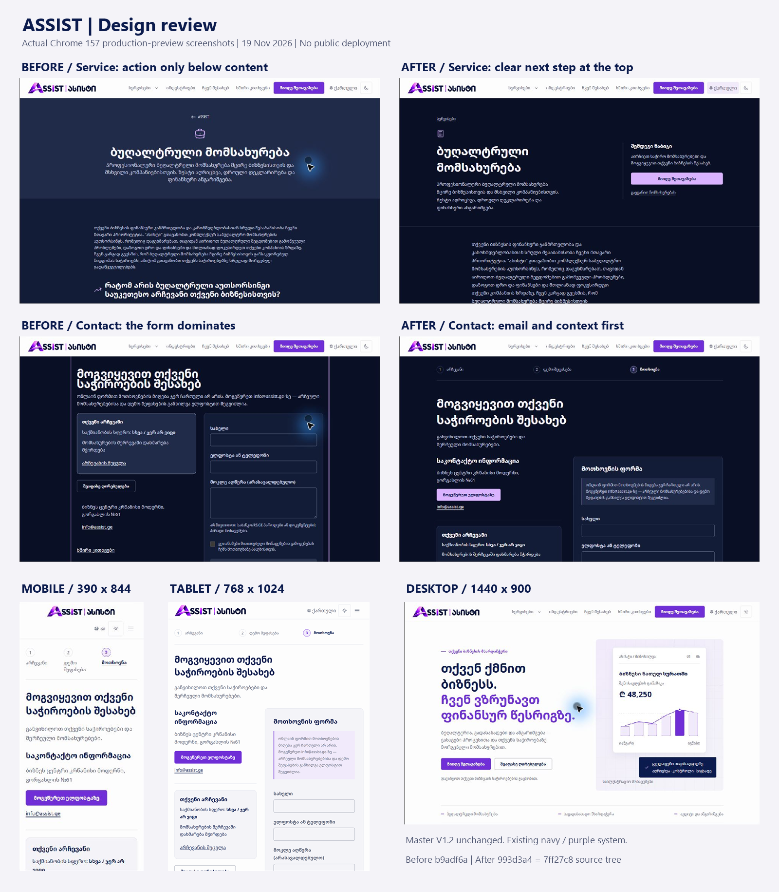
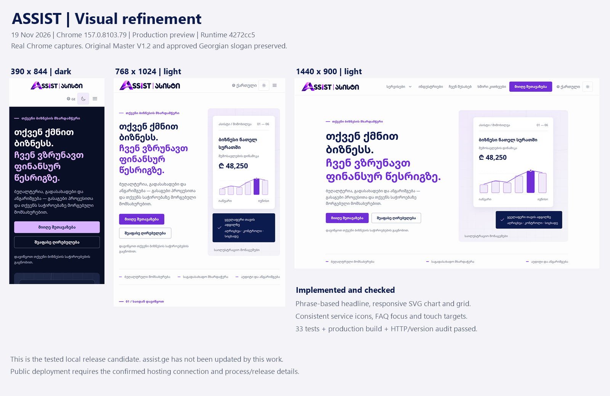

## ახალი მიმდინარე ეტაპი — დიზაინერული აუდიტი, 19 ნოემბერი 2026

**ამ დავალებაში merge/public deployment აკრძალულია.** ქვემოთ წინა გამოქვეყნების ნებართვა ისტორიულია და ამ ეტაპს არ ეხება. PR #1 უკვე გაერთიანდა; ახალი სამუშაოა [Draft PR #2](https://github.com/revaza88/assistpro/pull/2), `codex/assist-design-audit-2026-11-19`, main b9adf6a-დან. main ამ ეტაპზე არ შეცვლილა.

შემოწმებული აპლიკაცია [7ff27c8](https://github.com/revaza88/assistpro/commit/7ff27c81a6aa6730502e8901090dcc5a29ab9440), tree `3a1f7d05fbb74270ccf7a02ac6bccc0bcf9a388f`. რეალური browser993d3a4-ის მთლიანი tree ემთხვევა ამ GitHub commit-ს; canonical clean production build/HTTP audit ცალკე შესრულდა. [ახალი სრული ანგარიში](qa/2026-11-19-design-audit/README.md), [QA JSON](qa/2026-11-19-design-audit/current-run.json), [რეალური კადრების დაფა](qa/2026-11-19-design-audit/visual-board.png).

17 რეესტრის საკითხი გასწორდა: ექვსი მომსახურების ზედა მოქმედება, საერთო სათაურები/შინაარსის პროპორციები, არჩევანი→კალკულატორი→მოთხოვნა, კონტაქტის mailto პრიორიტეტი, About/Team/Career/FAQ, footer, ქართული narrow გადატანა, CSP-jitless validation და prerender CSS. Master PNG/სლოგანი/პალიტრა/ფონტები/API შენარჩუნდა. **check,35/35 ტესტი,build,smoke/audit-web/audit-release pass**. ეს ახალი ადგილობრივი შედეგებია; CI check/status0, წარმატებული CI არ დადასტურებულა.

Chrome157 production5016;320/390/768/1440 და კომპონენტების საზღვრები შერჩეულ შემთხვევებში, KA/EN/RU+თემები, კლავიატურა, scoped200%/spacing, reduced motion, რეალური Georgian font. desktop პრაქტიკული გზა2 მომსახურება+განათლება+თანამშრომლები7 მოთხოვნამდე და390-ზე შეჯამება დადასტურდა. ფორმის validation/loading/error/retry/success მხოლოდ loopback fixture-სიმულაციაა; upstream intake disabled, არც შენახვა და არც გარე გაგზავნა. preview/fixture შეჩერებულია.

დარჩენილია სრული კომბინაციური/ქვედა შინაარსის მატრიცა, ყველა control-state computed contrast, ყველა გვერდის200%/spacing, სხვა ბრაუზერები/ფიზიკური მოწყობილობა/AT, რეალური პროფილები/ფოტოები/ტელეფონი და მომხმარებლის საბოლოო ვიზუალური შეფასება. დასახელებული შერჩეული შემთხვევების განხილვა რეკომენდებულია; სრული მიღება არ გამოცხადებულა. ბაზა/intake/notifications/indexing გამორთული დარჩეს; შემდგომი მუშაობა გააგრძელეთ PR #2-ში.

---

## საჯარო გამოქვეყნება დადასტურდა — 19 ნოემბერი 2026

მომხმარებლის აშკარა თანხმობით („დიახ, გადაიტანე main-ზე“) [PR #1](https://github.com/revaza88/assistpro/pull/1) გაერთიანდა **main**-ში: [fbb86db](https://github.com/revaza88/assistpro/commit/fbb86db1b3fccc25c32c449766a3075c72929cd2). ეს ცვლის ამ დავალების წინა no-merge/no-deployment ფარგლებს. main-ის განახლებას მოჰყვა არსებული ავტომატური გამოქვეყნება **https://assist.ge**-ზე; ცალკე SSH შესვლა არ დაგვჭირდა. main-ის tree ზუსტად ემთხვევა შემოწმებულ a033a70-ს; აპლიკაციის კოდი დამატებით არ შეცვლილა.

ახალმა read-only HTTPS შემოწმებამ დაადასტურა 15 გვერდის HTTP200/ერთი H1/გამორთული intake/noindex/შესაბამისი CSP nonce; ოთხი ჩამოტვირთული საწყისი JS/CSS ფაილის ზომა და SHA-256 ზუსტად ემთხვევა შემოწმებულ build-ს. Master PNG-ის hash და ოთხივე ფონტის HTTP პასუხიც შემოწმდა. health200, არარსებული გვერდი404, robots200, გამორთული sitemap503. საჯარო POST არ გაგზავნილა. რეალური Chrome157-ში ნახულია მთავარი გვერდი KA dark390×844 და1440×900.

**გამოქვეყნება და წყაროს მეტამონაცემები გამიჯნულია:** /release.json უკვე200/no-store-ია და asset fingerprints სწორია, მაგრამ commit/tree/dirty null რჩება, რადგან ჰოსტინგის build-ს Git metadata/RELEASE_* არგუმენტები არ მიეწოდა. მკაცრი audit-release ამ მიზეზით კვლავ ვერ გადის; წარმატებად არ ჩაითვალოს. დარჩენილია build გარემოში RELEASE_COMMIT/RELEASE_TREE/RELEASE_DIRTY გადაცემა არსებული პანელის კონფიგურაციით. GitHub-ზე merge SHA-ს 0 workflow/check/status ჩანაწერი ჰქონდა; რეალური გამოქვეყნების მტკიცებულება HTTP/ფაილების შემოწმებაა, არა CI. სრული ვიზუალური მიღების ღია შემთხვევები ძალაში რჩება.

[საჯარო შემოწმების JSON](qa/2026-11-19-refinement/public-release.json) · [საჯარო მობილური კადრი](qa/2026-11-19-refinement/live-390.png) · [საჯარო desktop კადრი](qa/2026-11-19-refinement/live-1440.png). ქვემოთ არსებული „deployment დაბლოკილია/merge არ შესრულებულა“ ჩანაწერები აღწერს ამ თანხმობამდე მდგომარეობას.

---

## განახლება — ვიზუალური დახვეწა და გამოქვეყნების შემოწმება, 19 ნოემბერი 2026

შემოწმებული runtime: [`4272cc5584e2237455ed12cc58fdb3262dd7f802`](https://github.com/revaza88/assistpro/commit/4272cc5584e2237455ed12cc58fdb3262dd7f802), tree `ac79d6b1294b122ff26d33d29b09303c9ab7a120`. ამ განყოფილების შემდგომი ძველი ანგარიშები ისტორიულია. ახალი მტკიცებულებები: [JSON](qa/2026-11-19-refinement/current-run.json), [რეალური კადრების დაფა](qa/2026-11-19-refinement/visual-board.png).

### გეგმა და შესრულება

1. საჯარო ვერსიისა და კავშირის დადგენა: assist.ge პასუხობს, თუმცა ძველ JS/CSS-ს აწვდის და ახალი release.json 404-ია. GitHub ხელმისაწვდომია; SSH/PuTTY პროფილი, production env და გახსნილი ჰოსტინგის პანელი ვერ მოიძებნა. Sites-ის დამოუკიდებელი პროექტი არ ჩანაცვლებულა.
2. კომპოზიცია და ზომები: სათაური ორ აზრობრივ ნაწილად, 2.25–3.25rem დიაპაზონში; desktop grid 1.12fr/1fr, 48px დაშორება. უცვლელი ბრენდის ტოკენები და ქართული ტექსტი.
3. გრაფიკა: დახრილი ანგარიშის ნაცვლად პირდაპირი კომპოზიცია და 360×148 viewBox-ის ექვსსვეტიანი responsive SVG; დემო მონაცემების მკაფიო აღნიშვნა. ეს ახალი ლოგო არ არის.
4. კომპონენტები: მომსახურებების ექვსი შესაბამისი 28px/1.5stroke ხატულა, გასაგები ბმულის სახელები, თანმიმდევრული CTA, FAQ-ის 3px ფოკუსი და native გახსნა/დახურვა; footer ბმულები desktop 44px/mobile 48px.
5. რეალური QA: ახალი production Chrome კადრები, მობილური გზა, TypeScript/33 ტესტი/build და Windows/Linux container HTTP შემოწმება შესრულებულია.
6. ვერსიის გამოქვეყნება: კოდი იმავე განშტოებაზეა; სერვერის რელიზის დასრულებას რეალური ჰოსტინგის კავშირი სჭირდება. [რელიზის ინსტრუქცია](../RELEASE.md).

### გასწორებული საკითხები

| ID | პრობლემა და გავლენა | ცვლილება / შემოწმება |
| --- | --- | --- |
| REF-01 | სათაურისა და დახრილი ანგარიშის კონკურენტული იერარქია | აზრობრივი სათაური, პირდაპირი ანგარიში და responsive გრაფიკა; 320/390/768/1440-ის შერჩეული რეალური ხედები |
| REF-02 | დეკორატიული ისრები/ნომრები მომსახურების შინაარსს ფარავდა | ექვსი შესაბამისი ხატულა და მომსახურების სახელის შემცველი accessible link |
| REF-03 | dark თემაში გრაფიკის არააქტიური სვეტები სუსტად განირჩეოდა | მშვიდი ფონი + action outline და გამოკვეთილი აქტიური სვეტი; RU 320 dark ხელახლა ნანახია |
| REF-04 | FAQ კლავიატურის ფოკუსი დამატებით გამოყოფას საჭიროებდა | 3px outline; EN 769-ზე click/Enter გახსნა და დახურვა შემოწმებულია |
| REF-05 | HTTP 200 არ ადასტურებდა, რომ ახალი კოდი გაეშვა | build-ის release.json source SHA/tree/clean სტატუსით და საწყისი ფაილების hash/ზომის audit; ძველი assist.ge სწორად უარყოფილია |

### ახალი მტკიცებულებების ფარგლები

Windows Chrome **157.0.8103.79**, production **127.0.0.1:5014**; Node **26.13.1**, npm **11.20.0**. Docker Linux Node **24.22.3**, non-root/read-only image **assistpro:brand-4272cc5584e2**, loopback **5015**. ორივეგან smoke/audit-web/audit-release წარმატებულია; შემოწმდა ოთხი საწყისი asset-ის რეალური SHA/ზომა და 15 საჯარო HTTP მარშრუტი. TypeScript, **33/33 ტესტი**, production build (15 prerender +404) წარმატებულია; იგივე კოდის check/tests/build Docker build-შიც შესრულდა. საწყისი JS 341590 bytes / gzip 101092; CSS gzip 10856 — ბიუჯეტებშია. ეს Lighthouse-ის ახალი ქულები არ არის.

ახალი browser შემთხვევები: KA 1440×900 light, 768×1024 light/dark, 390×844 dark; EN/RU 320×844 და 390×844-ის შერჩეული ხედები; EN 766/769×844 breakpoint. მობილურზე განათლება + ბუღალტერია + სახელფასო მომსახურება → კალკულატორი → თანამშრომლები 5-დან 6-მდე → მოთხოვნა: ორივე სერვისი, ინდუსტრია, 6 და დემო 350–470 შენარჩუნდა. მიღება გამორთულია, ელფოსტა ჩანს; წარმატება არ სიმულირებულა. ზომები DevTools-ის ნომინალური CSS ზომებია, fit rounding-ის გათვალისწინებით. ახალი სრული DOM/computed მატრიცა არ ჩატარებულა. წინა ეტაპის ყველა-მარშრუტის browser მტკიცებულება ქვემოთ ცალკეა.

Master V1.2 სრული PNG და მისი SHA უცვლელია; სლოგანი ზუსტად „თქვენი ბიზნესის მხარდამჭერი“, Noto ფონტები და ორივე თემის #FDFDFD ბრენდული ზოლები შენარჩუნებულია. დარჩენილია სრული ენა/თემა/მდგომარეობების მატრიცა, 200%/text-spacing-ის სრული suite, UI ფორმის შეცდომა/განმეორება იზოლირებულ fixture-ში, სხვა ბრაუზერები/AT და მომხმარებლის ვიზუალური მიღება. ახალი ფიზიკური მოწყობილობა ან Lighthouse არ შემოწმებულა. ბაზა, production intake, გარე შეტყობინებები და merge არ გააქტიურებულა. საჯარო deployment არ შესრულებულა: რეალური სერვერის წვდომა არ არის დადგენილი.

---

# ASSIST 2.2 — Assistpro-ში განხორციელების ჩანაწერი

**თარიღი:** 19 ნოემბერი 2026, Asia/Tbilisi
**მდგომარეობა:** ახალი production Chrome შემოწმება შესრულებულია; ორი აღმოჩენილი ვიზუალური ხარვეზი გასწორებულია და ხელახლა შემოწმებულია. TypeScript, 31 ტესტი, build და HTTP smoke/audit წარმატებულია. სრული ვიზუალური მიღება ჯერ ღიაა ქვემოთ ზუსტად ჩამოთვლილი დაუტესტავი შემთხვევების გამო. [QA_v2_2.json](QA_v2_2.json) გამოყოფს ახალ და ისტორიულ მტკიცებულებებს.

## ახალი უშუალო შემოწმება — 19 ნოემბერი 2026

საწყისი GitHub HEAD იყო `0351f3589e1e6ecc59de833a96fccf079387babe`; სამუშაო გაგრძელდა იმავე `codex/assist-brand-system-2-2` განშტოებაზე და [Draft PR #1](https://github.com/revaza88/assistpro/pull/1)-ში. არსებული ცვლილებები შენარჩუნებულია. არ გამოყენებულა hard reset, force-push, merge ან deployment.

შემოწმებული საბოლოო runtime არის [`3ad8ad4`](https://github.com/revaza88/assistpro/commit/3ad8ad4bda7e70e41e0bf21edb4290f51a440fe5), ადგილობრივი `ea8ed8df3d721523c5ff66ff13ec706570b176a2`-ის ზუსტი ფაილთა ეკვივალენტი: Git tree `61fa0537946a36adc036486a05bfa246814ec34c`. GitHub-იდან fetch და tree diff წარმატებულია. შემდეგი commit-ები მხოლოდ მტკიცებულებებსა და დოკუმენტაციას ამატებს; მიმდინარე HEAD/CI ცალკე გადაამოწმეთ PR-ში.

| გარემო | ფაქტი |
| --- | --- |
| ბრაუზერი | Windows-ის რეალური Google Chrome **157.0.8103.79**; ვერსია დაყენებული executable-ის ProductVersion-დან |
| რეჟიმი / URL | **production build**, `http://127.0.0.1:5013`; დროებითი ლოკალური სერვერი, საჯარო deployment არ არის |
| Runtime | Node 26.13.1, npm 11.20.0 |
| ჩაკეტილი ფუნქციები | `INTAKE_MODE=disabled`, `INDEXING_ENABLED=false`; ბაზა და გარე შეტყობინებები არ გააქტიურებულა |
| UI მართვა | Windows Chrome native CUA. პირდაპირი browser DOM კონექტორი მიუწვდომელია. კონსოლის paste-ის დამცავი გაფრთხილება არ გადალახულა; Computed/Rendered Fonts შემოწმდა DevTools-ის ჩვეულებრივი ინტერფეისით. |
| ზომები | Chrome Device Toolbar-ის ნომინალური CSS სიგანეები. fit/DPR დამრგვალება არსებობს: 851-ზე body-ის computed width იყო 851.2px. DOM-ით პიქსელური overflow გაზომვა არ ჩატარებულა. |

### აღმოჩენილი და გასწორებული ხარვეზები

| ID | სად და რაში უშლიდა ხელს | ცვლილება / უშუალო გადამოწმება |
| --- | --- | --- |
| B22-01 | `/services/tax`, RU, 320×844: „консультирование“-ს ბოლო ასო ცალკე მესამე ხაზზე რჩებოდა. | 359px-მდე რუსული მომსახურების H1 არის 1.75rem; სიტყვა ახლა მთლიანად იკითხება. ხელახალი browser კადრი და სხვა რუსული მომსახურებების ვიწრო ხედები შემოწმებულია. [მანამდე](qa/2026-11-19/tax-320-ru-before.png) / [შემდეგ](qa/2026-11-19/tax-320-ru-after.png). |
| B22-02 | `/calculator`, RU, 1024×768: არჩეული მომსახურების ტიპი ნახევარი სიგანის select-ში იჭრებოდა. | საქმიანობისა და ტიპის ველები სრულ სვეტს იკავებს. 480px-მდე ტიპი დამატებით გადამტან ტექსტად ჩანს; native option უკვე იკითხება დამხმარე ტექნოლოგიისთვის, ამიტომ დუბლიკატს `aria-hidden` აქვს. თვიური/აღდგენის ვარიანტები 320-ზე და სრული ველი 1024-ზე შემოწმებულია. [პლანშეტი](qa/2026-11-19/calculator-1024-ru-after.png) / [მობილური](qa/2026-11-19/calculator-320-ru-after.png). |

შეიცვალა მხოლოდ `client/src/index.css` და `client/src/pages/calculator.tsx`. იგივე ორიგინალი PNG-ის SHA-256 უცვლელია: `449ff8c94c993a29bc58f9e0e43bb04d594088e367eeb015fd094fbd73191a5e`. გამოყენებულია Google Modern Web Guidance-ის `navbar`, `responsive-design`, `forms` და `improve-text-layout-and-legibility` სახელმძღვანელოები; native კონტროლები და არსებული არქიტექტურა შენარჩუნებულია.

### რეალურად გავლილი შემთხვევები

- ყველა 15 საჯარო მარშრუტი გაიხსნა რეალურ ბრაუზერში. 320×844 და 1440×900-ზე სხვადასხვა ენით დათვალიერდა თითოეული გვერდის საწყისი ხედი. მთავარი გვერდი და მოთხოვნის გზა დამატებით ჩამოისქროლა; ყველა მომსახურების მთელი ქვედა შინაარსის სრული მიღება **არ** დასტურდება. შემთხვევების ზუსტი ჯგუფებია [ახალ JSON ანგარიშში](qa/2026-11-19/current-run.json).
- დამატებით შემოწმდა 390×844, 768×1024, 844×390 და 1024×768. მთავარი გვერდის ინგლისური საწყისი ხედი შემოწმდა 359/360, 479/480, 540/541, 639/640, 767/768, 850/851, 1023/1024, 1279/1280 და 1439/1440 სიგანეებზე; კალკულატორი — 849/850/851-ზე. ეს spot check-ებია და არა ყველა გვერდის სრული კომბინაციური მატრიცა.
- მობილურ ქართულ გზაში: განათლება + ყოველდღიური ბუღალტერია + დეკლარაციები → კალკულატორი → თანამშრომლები 7 → მოთხოვნა. დესკტოპის ინგლისურ გზაში: განათლება + Bookkeeping + Tax advice → კალკულატორი → თანამშრომლები 9 → მოთხოვნა. არჩევანი და რიცხვები შენარჩუნდა. უარყოფით რიცხვზე გამოჩნდა ტექსტური შეცდომა, გასწორებისას შეფასება აღდგა. ორივე მოთხოვნის გვერდზე მიღება გამორთული იყო და ელფოსტის ალტერნატივა ჩანდა.
- ინგლისურ მობილურ მენიუში შესრულდა Tab, Shift+Tab, Space, Enter და Escape. Escape აბრუნებს ხილულ ფოკუსს trigger-ზე. დაბალ landscape ხედში მენიუ სკროლავს და ბოლო CTA მისაწვდომია.
- KA/EN/RU რენდერი, ღია/მუქი თემა და უცვლელი ქართული სლოგანი უშუალოდ დათვალიერდა. მუქ თემაში header/footer-ის computed ფონი არის `rgb(253,253,253)`, ლოგო სრულად, ჩარჩოს გარეშე ჩანს. ორივე ფონისა და ტექსტის observed computed წყვილები: ღია `#0B1B4D/#FDFDFD`, მუქი `#F7F5FF/#090F25`, footer `#5A6377/#FDFDFD`. შეფარდებები წერია JSON-ში; ეს სრული კონტრასტის აუდიტი არ არის.
- Rendered Fonts-ის Network რესურსებში დაფიქსირდა Noto Sans Georgian Regular/Bold და Noto Sans Regular/Bold, ქართულ/ლათინურ/კირილიცურ ტექსტში. ცოცხალი font-family-ის დეკლარაცია გამოყენებული glyph-ების მტკიცებულებად არ ჩანაცვლებულა.
- კალკულატორზე დროებით, DevTools html style-ით შემოწმდა `font-size:200%`, `letter-spacing:.12em`, `word-spacing:.16em` 851×900 და 320×900-ზე. header და მოქმედება ხელმისაწვდომი დარჩა ვერტიკალური სქროლით. descendant-ების ყველა არსებული override არ იძულებულა, ამიტომ სრული text-spacing suite ღიაა. დროებითი სტილი reload-ით წაიშალა.
- Rendering-ის `prefers-reduced-motion: reduce` რეჟიმში computed animation/transition duration ორივე `1e-05s` იყო. ემულაცია აღდგა.

### ახალი ადგილობრივი ტექნიკური შედეგები

ორივე აპლიკაციური შესწორების შემდეგ შესრულდა `npm run check`, `npm test` (**31/31**, 0 skipped) და `npm run build` (15 გვერდი + 404). საბოლოო build-ზე იმავე URL-ის `smoke-release.mjs` და `audit-web.ts` დასრულდა exit 0-ით. საწყისი JS: 338,662 B raw / 100,038 B gzip; CSS: 10,394 B gzip. ეს HTTP ბიუჯეტია, ახალი Lighthouse ან field Core Web Vitals არ გაზომილა.

GitHub runtime commit-ზე დაბრუნდა 0 PR workflow run, 0 commit status და 0 check-run. CI-ის წარმატება **არ** ცხადდება ადგილობრივი ტესტების საფუძველზე. არც workflow ფაილი დამატებულა მხოლოდ ამ ანგარიშისთვის.

### ახალი კადრები და ვიზუალური დაფა

სამივე საბოლოო კადრი გადაღებულია ზემოთ მითითებული საბოლოო runtime-ის production build-ზე Chrome DevTools Capture screenshot-ით (DPR 2). PNG-ები უცვლელია; დაფაზე მხოლოდ პროპორციულად შემცირდა. ხარვეზების კადრები native Chrome screenshot-ის საიტის viewport-მდე crop-ებია; ბრაუზერის fit მასშტაბი შენარჩუნებულია. ძველი ანგარიშის screenshot არ გამოყენებულა.

- [მობილური — 390×844, მუქი](qa/2026-11-19/final-home-390-dark.png)
- [პლანშეტი — 768×1024, ღია](qa/2026-11-19/final-home-768-light.png)
- [კომპიუტერი — 1440×900, ღია](qa/2026-11-19/final-home-1440-light.png)
- [შემაჯამებელი ვიზუალური დაფა](qa/2026-11-19/visual-board.png)
- [მუქი თემის ღია footer](qa/2026-11-19/footer-1440-dark.png)

### დარჩენილი მიღება და კონკრეტული მიზეზები

1. ყველა გვერდის × ზომის × ენის × თემის სრული მატრიცა და ყოველი მომსახურების ქვედა შინაარსი ამ სესიაში ბოლომდე არ შემოწმებულა. შემოწმებულ შემთხვევებში გამოყენების შემაფერხებელი გადაფარვა ან დაკარგული კონტექსტი აღარ გამოვლენილა; ეს დაუტესტავ შემთხვევებზე არ ვრცელდება.
2. ყველა კონტროლის normal/hover/pressed/focus/disabled/loading მდგომარეობის სრული computed მატრიცა არ ჩატარებულა. ფორმის ვალიდაცია, processing, გაგზავნის შეცდომა/ხელახალი ცდა და წარმატება ბრაუზერში ღიაა: მოქმედ სერვერზე მიღება მოთხოვნისამებრ გამორთული დარჩა. წარმატების სიმულაციაც არ შესრულებულა. ცალკე იზოლირებულ UI fixture-ში შემოწმება შესაძლებელია production intake-ის გააქტიურების გარეშე.
3. ყველა descendant-ზე იძულებითი text-spacing suite, ფიზიკური მოწყობილობები, სხვა ბრაუზერები და screen reader არ გამოყენებულა; მათი გავლა არ მიეწეროს ამ ანგარიშს.
4. პალიტრისა და მუქი ადაპტაციის საბოლოო მომხმარებლის შეფასება, არსებული favicon-ის პატარა ზომის შეზღუდვა და რეალურ დომენზე გაზიარება კვლავ ღიაა. ახალი ლოგო ან favicon არ შექმნილა.

**რეკომენდაცია:** ორი მიზნობრივი შესწორება შემოწმებულ შემთხვევებში მიღების ღირსია. სრული საიტის საბოლოო ვიზუალური მიღება და გამოშვება ჯერ არ გამოცხადდეს. Draft PR შენარჩუნდეს; merge/deployment/ბაზა/intake/გარე შეტყობინებები არ გააქტიურებულა. სატესტო სერვერი სამუშაოს დასრულებისას ჩერდება.

## ისტორიული საწყისი 2.2 შემოწმება

ქვემოთ შენარჩუნებულია წინა განხორციელებისა და preview-ის ანგარიში. მის runtime commit-ებსა და შეზღუდვებს ახალი შემოწმების სტატუსი არ მიეწეროს; მიმდინარე წყარო არის ზემოთ მოცემული ახალი ნაწილი.

## მოთხოვნა და ზუსტი სამიზნე

მომხმარებელმა ითხოვა წინა ვებბრენდბუქის გასწორება, ლოგოს ჩარჩოს მოხსნა, ინტერფეისის გაუმჯობესება და გეგმის ეტაპობრივი შესრულება; შემდეგ მიაწოდა [revaza88/assistpro](https://github.com/revaza88/assistpro). ეს პროექტი არის მიმდინარე სამიზნე. ძველი Sites კონცეფცია დამოუკიდებელი პროექტია.

| ველი | მნიშვნელობა |
| --- | --- |
| რეპოზიტორია | `revaza88/assistpro` |
| საწყისი commit | `ad8637e2f8d24426f8d46b60a1e6f566d3748622` |
| მიმდინარე განშტოება | `codex/assist-brand-system-2-2` |
| შემოწმებული კოდის commit | ადგილობრივი `d0e24553b498ba6648b8eaee5020cf9a4bebf124`; გამოქვეყნებული ეკვივალენტი [`59ad55f`](https://github.com/revaza88/assistpro/commit/59ad55f16149f158d1f7ef49fbfe213af329aa31). ორივეს Git tree არის `7129367fa886d66383314a24021ca41072745df5`; შემოწმებული ფაილები იდენტურია. |
| GitHub-ზე გადატანა / PR | მომხმარებლის 19 ნოემბრის 2026 მკაფიო მოთხოვნით გამოქვეყნებულია [სამუშაო განშტოება](https://github.com/revaza88/assistpro/tree/codex/assist-brand-system-2-2) და [Draft PR #1](https://github.com/revaza88/assistpro/pull/1). მთავარი განშტოება უცვლელია; merge და საჯარო deployment არ შესრულებულა. გაგრძელება: [Codex-ის დავალება](CODEX_CONTINUE.md). |
| ბრენდსისტემის წყარო | ASSIST Brand System 2.2 |
| ლოგოს დიზაინი | ორიგინალი Master V1.2, უცვლელი |
| გამოქვეყნებული საიტის მისამართი | ამ ჩანაწერით საჯარო deployment არ დასტურდება |

## წყაროსა და დოკუმენტაციის დადასტურებული შედეგი

| შემოწმება | შედეგი / ფარგლები |
| --- | --- |
| PNG-ის იდენტობა | მიმდინარე საჯარო PNG, `docs/brand/reference/` ასლი და 2.2 პაკეტის PNG ბაიტობრივად იდენტურია |
| SHA-256 / ზომა | `449ff8c94c993a29bc58f9e0e43bb04d594088e367eeb015fd094fbd73191a5e`; 1405 × 235; 242,575 B |
| Master-ის ტექნიკური წარმომავლობა | გადმოტანილია 2.2-ში ჩატარებული წყაროს კვლევის [დოკუმენტი](LOGO_PROVENANCE.md) და [JSON ჩანაწერი](logo-provenance.json); წყაროს კვლევა ამ რეპოზიტორიის browser QA არ არის |
| მიმდინარე წესები | `BRAND_FOR_WEB.md`, manifest და AGENTS-ის ბრენდის სექცია განახლებულია 2.2-ზე; არქიტექტურის სხვა მითითებები შენარჩუნებულია |
| ისტორია | 18 ნოემბრის ანგარიშები მონიშნულია ისტორიულად; ძველი შედეგები ახალ ტესტებად არ გადმოტანილა |
| ფაილების მოცულობა | სრული PDF/ZIP და საოფისე შაბლონები არ დამატებულა საჯარო რეპოზიტორიას; სრული გამოცემის ბმულები მოქმედ წესებშია |

## განხორციელების ფარგლები

| შეცვლილი ადგილი | რეალური ცვლილება და მიზეზი |
| --- | --- |
| `client/src/brand-tokens.css`, `index.css`, `tailwind.config.ts` | ერთი runtime წყარო 2.2 ღია ფერებისთვის; საიტის მუქი კონტენტის ადაპტაცია; კონტროლების, ფოკუსისა და loading/disabled მდგომარეობები |
| `BrandLogo.tsx`, header/footer-ის სტილები | სურათის დეკორატიული wrapper მოხსნილია; უცვლელი PNG უშუალოდ სრულსიგანიან `#FDFDFD` ბრენდულ ზოლებზე; 280/220/200 px სამუშაო ზომები rem-ით |
| `fonts.css`, `client/index.html`, `assets/fonts/assist-v2/` | Noto Sans Georgian/Noto Sans 400/700, ოთხი WOFF2, ლიცენზია და manifest; კრიტიკული ქართული Regular preload |
| `components/ui/button.tsx` | საერთო ღილაკების როლები, focus/pressed/loading/disabled და forced-colors ქცევა |
| `pages/contact.tsx` | დამუშავებისას `aria-busy`, მდგომარეობების სემანტიკური ტექსტური სტილები; disabled fieldset-ის საერთო გამჭვირვალობა მოხსნილია, რათა loading კონტრასტი არ შემცირდეს |
| `pages/career.tsx` | რეალური `#open-positions` სამიზნე; უმოქმედო მოქმედებები დაკავშირებულია ვაკანსიების ბლოკთან ან დადასტურებულ ელფოსტასთან |
| `pages/team.tsx` | nested link/button ჩანაცვლებულია ერთი ინტერაქტიული ბმულით `asChild`-ის მეშვეობით; მიზანი `/career` შენარჩუნებულია |
| `index.css` — `.calculator-check input` | კალკულატორის checkbox-ის აქცენტი მიბმულია სემანტიკურ `var(--action)`-ზე |
| `pages/services/business.tsx` | ცარიელ სექციაზე მიმავალი მეორეული CTA და ცარიელი სამიზნე მოხსნილია; არსებული კონსულტაციის გზა შენარჩუნებულია |
| `package.json` | dev/build იყენებს `node --import tsx`-ს; იგივე რეგისტრაცია უკვე გამოიყენებოდა პროექტის ტესტებში; დამოკიდებულებები არ შეცვლილა |

CTA-ის შესწორებები აღმოჩენილი მოქმედების ხარვეზების ფარგლებშია. ახალი ბიზნესფაქტი, დაპირება, ტარიფი ან API შესაძლებლობა არ დამატებულა.

არსებული მარშრუტები, ბიზნესკონტენტი, კომპანიის ავტორიზებული მონაცემები, ენების lazy loading, თემის არჩევანი, API, CSP და noindex შენარჩუნებულია. ახალი ლოგო ან favicon არ შექმნილა. ბაზა, production intake და გარე შეტყობინებები ამ დავალების ფარგლებში არ გააქტიურებულა.

## მიმდინარე შემოწმება

| სფერო | ფაქტობრივი შედეგი | მტკიცებულება / ზღვარი |
| --- | --- | --- |
| TypeScript | წარმატებულია | `npm run check` |
| ავტომატური ტესტები | 31/31 წარმატებულია; 0 ჩავარდნა, 0 გამოტოვება | `npm test`; მათ შორის ლოკალური HTTP/API, CSP, theme/locale და რესურსის იდენტობა |
| Production build / prerender | წარმატებულია: Vite + 15 საჯარო მარშრუტი და 404-ის prerender + server bundle | შესწორებული `npm run build`; საწყისი CLI პრობლემა ქვემოთაა აღწერილი |
| ტოკენები / კონტრასტის გამოთვლა | 19 ღია ფერის როლი ემთხვევა პაკეტს; 29/29 დეკლარირებული ფერის წყვილი გადის შესაბამის ზღვარს | [QA_v2_2.json](QA_v2_2.json); source-token გამოთვლა, არა browser computed-style აუდიტი |
| HTTP / API | იზოლირებული production smoke და web audit წარმატებულია; 15 მარშრუტი, 404, metadata/CSP/cache/gzip, robots/sitemap/query noindex და disabled POST 503 | `INTAKE_MODE=disabled`, `INDEXING_ENABLED=false`; ტესტის სერვერი შეჩერებულია |
| ბრაუზერი / ზომები / მენიუ | **არ შესრულებულა** | preview daemon-ის startup timeout; URL არ დაბრუნებულა. ახალი screenshot არ შექმნილა |
| ფონტები / EN / RU / ქართული | ოთხი WOFF2 და ლიცენზია წყაროს ემთხვევა; PNG და ოთხივე ფონტი HTTP-ითაც იდენტური ბაიტებით გაიცა | glyph/sample და locale ავტომატური შემოწმება შესრულებულია; browser-ში რეალური ფონტის გამოყენება და ტექსტის რენდერი დაუტესტავია |
| 200% ტექსტი / reduced motion | **browser-ში არ შემოწმებულა** | შესაბამისი CSS წესები კოდშია; პრაქტიკული UI შედეგი დარჩენილია |
| საჯარო განთავსება | არ დასტურდება | დომენი/ჰოსტინგი ცალკე სამიზნეა |

წარუმატებელი ან მიუწვდომელი შემოწმება არ მონიშნოს წარმატებულად. სტატიკური ფაილის შემოწმება, გაშვების მცდელობა და ისტორიული screenshot მიმდინარე ბრაუზერის მტკიცებულებას არ ანაცვლებს. რეალური შეზღუდვა ჩაიწეროს ზუსტი მიზეზით.

## აღმოჩენილი გაშვების პრობლემა და შესწორება

საწყისი `npm run build`-ის Vite ფაზა დასრულდა, შემდეგ `tsx` CLI-მ თავისი IPC pipe-ის შექმნაზე დააბრუნა `EPERM` (`/tmp/tsx-1000/55.pipe`). იგივე ტიპის შეცდომამ preview-ის პირველი მცდელობაც შეაფერხა. უშუალო `node --import tsx scripts/prerender.ts` წარმატებით შესრულდა, ამიტომ dev/build script-ში გამოყენებულია Node-ის import რეგისტრაცია; აპლიკაციის სერვერისა და API-ის არქიტექტურა უცვლელია. შესწორებული სრული `npm run build` წარმატებით დასრულდა. Preview-ის ხელახალი მცდელობა აპლიკაციის გაშვებას გასცდა, თუმცა ქვემოთ აღწერილ ინფრასტრუქტურულ შეზღუდვაზე შეჩერდა.

ტექნიკური წყაროები: [tsx-ის Node CLI მითითება](https://github.com/privatenumber/tsx/blob/master/docs/dev-api/node-cli.md) და [Node.js-ის TypeScript გაშვების სახელმძღვანელო](https://github.com/nodejs/learn/blob/main/pages/typescript/run.md).

## სტატიკური HTML და HTTP მტკიცებულება

16 გენერირებულ HTML-ში (15 გვერდი + 404) შემოწმებულია: თითო H1, ორი სრული ორიგინალი PNG ზუსტი საწყისი ზომებით, ქართული სლოგანი, მოქმედი fragment სამიზნეები, განმეორებული ID-ების, nested anchor/button-ისა და NUL ბაიტების არქონა. ეს გენერირებული HTML-ის შემოწმებაა და რეალურ viewport-ში რენდერს არ ამტკიცებს.

იზოლირებული production ტესტი შესრულდა `http://127.0.0.1:42105`-ზე ბრძანებებით `node scripts/smoke-release.mjs` და `node --import tsx scripts/audit-web.ts`, იმავე საბაზისო URL-ის არგუმენტით. ორივე დასრულდა exit code 0-ით. ეს დროებითი loopback მისამართია; სერვერი შემოწმების შემდეგ შეჩერებულია და საჯარო preview არ არის.

| საწყის HTML-ში გამოცხადებული რესურსები | გაზომვა | არსებული ბიუჯეტი |
| --- | ---: | ---: |
| JavaScript, raw | 338,662 B | 400,000 B |
| JavaScript, gzip | 100,042 B | 120,000 B |
| CSS, gzip | 10,328 B | 12,000 B |

ბიუჯეტში შედის საწყისი shared modulepreload-ებიც. ეს ცხრილი არ მოიცავს ლოგოს, ფონტებსა და მოგვიანებით ჩატვირთულ dynamic import-ებს; სრული გვერდის წონა, Lighthouse ან რეალურ მომხმარებლებთან Core Web Vitals აქ არ გაზომილა. ორიგინალი PNG და ოთხივე ახალი WOFF2 ცალკე HTTP შემოწმებაში წყაროს იდენტური ბაიტებით გაიცა.

## ბრაუზერის პრაქტიკული შემოწმების შეზღუდვა

დოკუმენტირებული preview გზის ხელახალი ცდისას აპლიკაცია გაეშვა `0.0.0.0:5000`-ზე, მაგრამ preview daemon-ის startup დასრულდა timeout-ით და გასახსნელი URL არ დაბრუნებულა. პროცესი შეჩერებულია. ამ ეტაპზე ახალი browser QA ან screenshot არ შესრულებულა.

დარჩენილია 320/390/768/1440 CSS px, რეალური breakpoint-ები და ორიენტაციები, თემების/ენების რენდერი, ფონტის ფაქტობრივი გამოყენება, keyboard menu/focus/Escape, 200% ტექსტი/ინტერვალები, reduced motion და ფორმის ხილული მდგომარეობები. ძველი screenshot-ები, source-token კონტრასტი და წარმატებული HTTP პასუხი ამ შედეგებს არ ანაცვლებს.

## მუქი კონტენტის ადაპტაციის სტატუსი

ეს არის არსებული საიტის თემის შესანარჩუნებლად განხორციელებული წინადადება, არა ახალი Master ან მუქი ლოგოს ვარიანტი. ლოგოს ორივე ბრენდული ზოლი ისევ `#FDFDFD`-ზეა.

| როლი | ფაქტობრივი runtime მნიშვნელობა |
| --- | --- |
| Canvas / surface | `#090F25` / `#121C37` |
| Ink / muted | `#F7F5FF` / `#C7CCE0` |
| Action / hover / pressed | `#D9B3FF` / `#E6CCFF` / `#C99BF2` |
| Tint / rule / control | `#202A49` / `#455071` / `#8D98B5` |
| Focus | `#D9B3FF`; ღია header/footer-ში ღია თემის იასამნისფერი |
| Success / surface | `#82DCB1` / `#123A2B` |
| Error / surface | `#FFB4BC` / `#3A1B29` |
| Warning / surface | `#F4D28A` / `#342A17` |
| Disabled / ink | `#27334F` / `#B2BAD0` |

გამოთვლილი დეკლარირებული ფერების მაგალითები: dark ink/canvas **17.58:1**, muted/surface **10.54:1**, navy label/action **9.27:1**, control/surface **5.85:1**, success/error/warning შესაბამის ფონებზე **7.70/9.14/9.69:1**. Loading-ის თეთრი ტექსტი იასამნისფერ ფონზე **6.91:1**-ია. ეს source-token წყვილების გამოთვლაა; browser-ის computed-style ან სრული WCAG შემოწმება არ არის.

## დარჩენილი მიღება

ახალი UI განხორციელებული წინადადებაა და ვიზუალური მიღება დარჩენილია. ცალკე დარჩენილია დაუტესტავი ბრაუზერები/მოწყობილობები და assistive technology, სრული-PNG favicon-ის პატარა ზომის შეზღუდვა, რეალური დომენის გაზიარების preview და production განთავსება. საჯარო დომენი/ჰოსტინგის სამიზნე ამ რეპოზიტორიაში დადასტურებული არ არის; ბაზა და რეალური ონლაინ მიღება კვლავ გამორთულია. წყაროს ტექნიკური წარმომავლობა დახურული საკითხია და თავიდან დასადგენად არ დაბრუნდეს.
