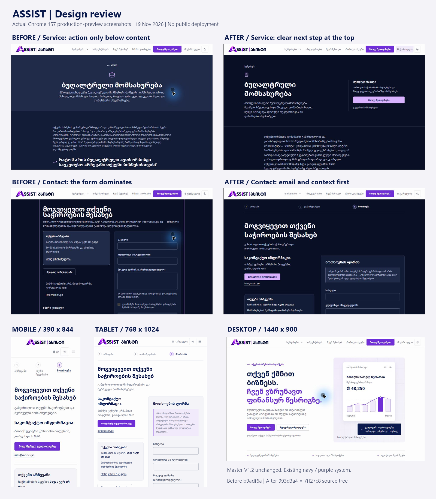

# ASSIST — ახალი დიზაინერული აუდიტი, 19 ნოემბერი 2026

ეს არის **ახალი ადგილობრივი production შემოწმება**, არა assist.ge-ის ახალი გამოქვეყნება. PR #1 უკვე გაერთიანებული იყო; სამუშაო დაიწყო სუფთა main `b9adf6a7cce5ba639305e76323782d7fad3c8102`-დან. [Draft PR #2](https://github.com/revaza88/assistpro/pull/2), განშტოება `codex/assist-design-audit-2026-11-19`. Merge და საჯარო deployment ამ დავალებაში აკრძალულია.

შემოწმებული საბოლოო აპლიკაცია: [`7ff27c81a6aa6730502e8901090dcc5a29ab9440`](https://github.com/revaza88/assistpro/commit/7ff27c81a6aa6730502e8901090dcc5a29ab9440), tree `3a1f7d05fbb74270ccf7a02ac6bccc0bcf9a388f`. რეალური საბოლოო კადრები გადაღებულია ადგილობრივ `993d3a4a87aa648125e5582b43d2af74f0957f00`-ზე; მისი **მთლიანი tree ზუსტად ემთხვევა** GitHub-ის 7ff27c8-ს. GitHub-ის canonical commit-ით clean build და HTTP release audit ცალკე შესრულდა. უფრო ადრეული შუალედური კადრები browser-log.json-ში შესაბამისი source/phase-ითაა შენარჩუნებული; ახალი საბოლოო კადრებად არ ჩაითვალოს.

## გეგმა და არტდირექცია

1. ინსტრუქციები, ბრენდის რეესტრი, მიმდინარე GitHub/PR და საწყისი production კადრები.
2. პრობლემების რეესტრი და საერთო სისტემა: მარცხნივ გასწორებული სათაური, 24ch სათაურის საზღვარი, 68ch კითხვის სიგრძე, 32–48px H1/1.35 სტრიქონი, 18px ძირითადი ტექსტი/1.8, საერთო სივრცეების ტოკენები.
3. საერთო PageHeader/ServiceIntro/JourneySteps, header/footer/კონტროლები; შემდეგ მომსახურებები, არჩევანი, კალკულატორი, კონტაქტი, კომპანია/გუნდი/კარიერა/FAQ/404.
4. რეალური ბრაუზერი, ძირითადი გზა, responsive საზღვრები და ფორმის იზოლირებული მდგომარეობები; აღმოჩენილი ქართული გადატანისა და ხანგრძლივი მობილური შესავლის ხელახალი შესწორება.
5. check/tests/build/HTTP, რეალური კადრების დაფა, მიმდინარე მიღება და გადასახედი PR. განხორციელებულია; ქვემოთ დარჩენილი ფარგლები გამოყოფილია.

მიმართულება ეფუძნება არსებულ navy/purple სისტემას: იასამნისფერი მოქმედებებისთვის, მშვიდი ერთიანი ფონი, მსუბუქი საზღვრები, შინაარსის იერარქია დეკორატიული ბარათების დამატების ნაცვლად. მომსახურებებს აქვს სათაური + შემდეგი ნაბიჯი; კომპანიის ამბავსა და მისიას — სვეტები; შერჩევას — ჯგუფები + შეჯამება; კალკულატორს — ველები + რიცხვითი შედეგი; კონტაქტს — რეალური საკონტაქტო გზა + მოთხოვნის კონტექსტი. მთავარი გვერდის არსებული ილუსტრაცია შენარჩუნებულია.

## გასწორებული რეესტრი

| ID / პრიორიტეტი | გვერდი / ხარვეზი და გავლენა | შესწორება და მტკიცებულება |
| --- | --- | --- |
| D01 / P1 | ექვს მომსახურებაზე მოქმედება მხოლოდ გრძელი ტექსტის შემდეგ ჩანდა | ზედა ServiceIntro, წინასწარ არჩეული მომსახურება → industries; desktop და business320/390 გადამოწმებულია |
| D02 / P2 | /services-ზე ორმაგი სათაური იერარქიას არღვევდა | ერთი PageHeader + არსებული ექვსი მომსახურება; რეალური desktop |
| D03 / P1 | /contact-ზე გამორთული ფორმა ელფოსტას ჩრდილავდა | საკონტაქტო ბლოკი და mailto პირველ რიგში, გამორთული ფორმის დაკავშირებული განმარტება; 320/390/768/1440 |
| D04 / P2 | /team-ის ორი ერთნაირი კარიერის მოქმედება | ერთი მოქმედება, ნეიტრალური სათაური, გამოგონილი თანამშრომლების გარეშე |
| D05 / P2 | კალკულატორის ორი რიცხვითი ველის სათაური სხვადასხვა სიმაღლეს ქმნიდა | საერთო მინიმალური label სიმაღლე, tabular რიცხვები; 540/541 და 849/850/851 ვიზუალური შემოწმება |
| D06 / P3 | footer-ის რვა ერთსვეტიანი ბმული დიდ ცარიელ სივრცეს ქმნიდა | ორსვეტიანი ბმულები; desktop footer უშუალოდ ნანახია |
| D07 / P2 | პროგრამულ main ფოკუსს გვერდის გარშემო ჩარჩო მოჰქონდა | მხოლოდ landmark outline მოხსნილია; კონტროლების მკაფიო focus რჩება, Tab/Shift+Tab ნანახია |
| D08 / P1 | Zod-ის JIT მკაცრ CSP-ში eval-ის მცდელობას აჩენდა | საერთო jitless კონფიგურაცია; ახალი CSP regression test, ახალი Chrome contact-ზე კონსოლის/Issues შეცდომა აღარ ჩანს |
| D09 / P3 | header-ის select-ებს name აკლდა | ენისა და თემის native select-ებს name მიენიჭა; Chrome issue hint აღარ ჩანს |
| D10 / P2 | 404 მხოლოდ ინგლისურად იყო | KA/EN/RU საერთო სისტემა და მკაფიო მთავარი გვერდის ბმული; KA404 რეალურად ნანახია, დანარჩენი თარგმანები კოდშია |
| D11 / P2 | About/Career გრძელი სარეკლამო სათაურები გვერდის მიზანს აყოვნებდა | მოკლე PageHeader და ნეიტრალური შესავალი; არსებული ბიზნესშინაარსი შენარჩუნდა |
| D12 / P1 | არჩევანის მთავარი მოქმედება კალკულატორს გვერდს უვლიდა | მთავარი CTA დემო შეფასებაზე, პირდაპირი მოთხოვნა მეორეულად; 2 მომსახურება + განათლება + თანამშრომლები7 მოთხოვნამდე გადატანილია |
| D13 / P2 | 320-ზე გუნდისა და კარიერის ქართული სიტყვების ბოლო ასო ცალკე რჩებოდა | ვიწრო სათაურის ზომა და ხატულის ტექსტის ზემოთ გადატანა; before/after320 და 359/360/390 გადამოწმებულია |
| D14 / P1 | Business-ის გრძელი mobile შესავალი მოქმედებას პირველი ეკრანიდან წევდა | mobile რიგი: სათაური → შემდეგი ნაბიჯი → აღწერა; 320/390 KA და320 RU რეალურად ნანახია |
| D15 / P3 | FAQ სხვადასხვა სიგანის/გასწორების სვეტებს ქმნიდა | ერთი საერთო სიგანე და ღერძი; FAQ Enter/Space/focus რეალურად შემოწმებულია |
| D16 / P2 | About-ის უწყვეტი ტექსტი და ქვემოთ გაწეული მისია ართულებდა სკანირებას | აბზაცები, ამბავი + მისია desktop გვერდიგვერდ, მობილურზე სწორი რიგი |
| D17 / P1 | ახალი lazy page CSS-ის მხოლოდ JS-ით ჩატვირთვა prerender-ს უსტილოდ დატოვებდა | Express inner HTML head-ში hash-იანი stylesheet; ახალი regression test +15 HTML/CSS პასუხის უშუალო HTTP შემოწმება |

## უშუალო გარემო და შესრულებული შემოწმება

Windows, Google Chrome **157.0.8103.79**, Node **26.13.1**, npm **11.20.0**. რეალური native Chrome, DevTools responsive emulation; production **http://127.0.0.1:5016**. ნომინალური CSS ზომები fit-to-window rounding-ით; მაგალითად 320 მითითება შეიძლება 320.4 გამოთვლილ px-ს ნიშნავდეს. ფიზიკური ტელეფონი/პლანშეტი არ გამოყენებულა. DOM ავტომატიზაციის კავშირი მიუწვდომელია; UI შემოწმდა native კონტროლებით, პროგრამული overflow მატრიცა არ ჩატარებულა.

- 15 საჯარო მარშრუტის +404-ის პირველი ეკრანები ნანახია 1440×900-ზე KA dark-ში შუალედურ საბოლოო კომპოზიციაზე; ბოლო mobile შესწორებების დაზიანებული Team/Career/Business შემთხვევები ხელახლა ნანახია საბოლოო წყაროზე. მთავარი გვერდის სერვისები/გზა/FAQ/CTA/footer და HR-ის ქვედა შინაარსი დამატებით გადაისქროლა. ყველა გვერდის ყოველი ქვედა პიქსელი და ყველა კომბინაცია სრულად არ აუდიტირებულა.
- ძირითადი გვერდების შერჩეული რეალური შემთხვევები: Home, Business, Industries, Calculator, Contact, Team, Career — 320/390/768/1440 CSS px. Desktop ყველა მარშრუტი, ქვედა mobile შემთხვევები და დრო/წყაროები [browser-log.json](browser-log.json)-ში. ზოგი შემთხვევა შუალედურ b6cd56e-ზეა; მისი შემდგომი ლოკალური ცვლილებები მხოლოდ მითითებულ narrow კომპოზიციებს შეეხო და ეს შემთხვევები საბოლოო წყაროზე გამეორდა.
- კომპონენტების საზღვრები: 359/360 (Team), 479/480 და1439/1440 (header), 540/541 (რიცხვითი ველები), 766/767/768 (hero/service grid), 849/850/851 (კალკულატორი), 1022/1023/1024 (არჩევანის summary). fit rounding-ის გამო ზოგი ნომინალური ზღვრისთვის დამატებითი ქვედა სიგანე გამოყენებულია. Accounting844×390 landscape-ზე ტექსტი გადაადგილებადია, მოქმედება არ იკარგება; ყველა ორიენტაციის სრული მატრიცა არ ჩატარებულა.
- KA light/dark; EN contact390 dark და business390 dark; RU business/calculator320 dark — წაკითხვადი სათაურები/მოქმედებები. EN/RU მთლიანი საიტის სრული მატრიცა ღიაა. სლოგანი უცვლელად ქართულად რჩება.
- desktop პრაქტიკული გზა: განათლება + ყოველდღიური ბუღალტერია + საგადასახადო კონსულტაცია → კალკულატორი → თანამშრომლები5→7 → მოთხოვნა. URL/შეჯამება ინარჩუნებს ორივე მომსახურებას, განათლებას, 7-ს და დემო360–480-ს. იგივე მოთხოვნის გვერდი390-ზე გადამოწმდა. ამ ახალ ეტაპზე მთელი გზა მეორედ მხოლოდ mobile კლიკებით არ გამეორებულა.
- Mobile menu: click/Space გახსნა, Tab პირველ ბმულზე, Escape დახურვა და ფოკუსის დაბრუნება; Shift+Tab თემაზე გადასვლა ხილული outline-ით. FAQ click/Space/Enter გახსნა/დახურვა და ხილული ფოკუსი.
- DevTools Rendering-ში `prefers-reduced-motion: reduce` უშუალოდ არჩეულია; გვერდი რჩება მართვადი. ყველა გარდამავალი მდგომარეობის დროის ინსტრუმენტული გაზომვა არ ჩატარებულა.
- DevTools Rendered fonts: ქართული H1 რეალურად **Noto Sans Georgian**, **NotoSansGeorgian-Bold**, network resource(21glyphs). გამოთვლილი dark H1 `rgb(247,245,255)`, root ფონზე `rgb(9,15,37)`; light root `rgb(253,253,253)`/ტექსტი `rgb(11,27,77)`. სრული hover/pressed/color-state computed მატრიცა ღიაა; არსებული ფერები უცვლელია. EN/RU-ს რეალური glyph-font პანელი ცალკე არ შემოწმებულა.
- ტექსტის200% root-font გადიდება იზოლირებული loopback CSS fixture-ით Contact320-ზე: შინაარსი გრძელდება ვერტიკალურად, mailto მოქმედება გადატანით მისაწვდომია. იძულებითი WCAG text-spacing fixture Calculator320-ზე: ველები/სათაურები არ იფარება. ეს შეზღუდული სცენარებია და არა ყველა გვერდის სრული200%/spacing მიღება; ისინი fixture CSS-ით შესრულდა, ბრაუზერის Zoom/OS პარამეტრად არ ჩაითვალოს.

### ფორმის სიმულაცია — რეალური მიღების გარეშე

Production upstream5016 **INTAKE_MODE=disabled, INDEXING_ENABLED=false** მთელი შემოწმებისას. loopback-only5017 UI fixture მხოლოდ HTML-ის form availability meta-ს ცვლის, ყველა non-GET/HEAD მოთხოვნას ბლოკავს upstream-მდე და პასუხებს თვითონ აბრუნებს; არაფერი ინახება/იგზავნება. fixture/სატესტო მონაცემები აპლიკაციაში არ დამატებულა.

ცარიელი submit → სახელის/კონტაქტის/თანხმობის გასაგები შეცდომები და ფოკუსი სახელზე; შევსება მხოლოდ `QA Tester`, `qa@example.invalid`, QA შეტყობინებით; 7-წამიანი loading → disabled ველები/„იგზავნება…“; სიმულირებული503 → წითელი alert და შენარჩუნებული მონაცემები; განმეორება → სიმულირებული201/მწვანე status და ფორმის გასუფთავება. 2 fixture request დათვლილია. არსებული success ტექსტი local საცდელ შენახვას აღწერს, მაგრამ **ამ fixture-ში შენახვაც არ მომხდარა**. ეს UI-ს ტესტია, API რეალური მიწოდების ან production intake-ის მტკიცებულება არაა. სერვერის რეალური disabled POST ცალკე smoke-ით503-ია.

### ახალი ავტომატური შემოწმებები

- `npm run check` — pass.
- `npm test` — **35 pass,0 fail,0 skip**. ორი ახალი მნიშვნელოვანი regression test: Function-ის აკრძალვისას schema validation; inner HTML-ში CSS წინასწარი ჩატვირთვა და path უსაფრთხოება.
- `npm run build` — pass,15 prerender+404. canonical7ff27c8 clean build-ის release.json `dirty:false`, tree3a1f7d0.
- `node scripts/smoke-release.mjs http://127.0.0.1:5016` — pass.
- `node --import tsx scripts/audit-web.ts http://127.0.0.1:5016` — pass,15 გვერდი, metadata/status/gzip/cache/ბიუჯეტები/robots/sitemap/query noindex. [HTTP ანგარიში](http-audit.json).
- `node scripts/audit-release.mjs http://127.0.0.1:5016 7ff27c81a6aa6730502e8901090dcc5a29ab9440` — pass,5 asset-ის SHA/ზომა და clean source identity.
- დამატებითი HTTP:14 შიდა გვერდი+404 head-ში page-system CSS, ყველა stylesheet200. ეს HTTP/ტესტის მტკიცებულებაა, ახალი no-JavaScript browser შემოწმება არაა.
- საწყისი JS341892 bytes/gzip101650; CSS gzip10858. Local unthrottled HTTP **არ არის ახალი Lighthouse/CWV გაზომვა**. Docker/სხვა ბრაუზერების ძველი შედეგები ახალ შემოწმებად არ არის წარმოდგენილი.
- JIT-ის გადაწყვეტილება მიჰყვება [Zod-ის ოფიციალურ CSP ინსტრუქციას](https://zod.dev/compile): `z.config({jitless:true})`, `unsafe-eval` არ დამატებულა.

## ბრენდი, მტკიცებულება და დარჩენილი მიღება

Master V1.2 PNG უცვლელია:1405×235, SHA256 `449ff8c94c993a29bc58f9e0e43bb04d594088e367eeb015fd094fbd73191a5e`. Header/footer #FDFDFD ორივე თემაში; ზუსტი ქართული სლოგანი და ცარიელი ქვედა service descriptor. ლოგოს გარშემო ახალი ჩარჩო/ჩრდილი/ფირფიტა არ დამატებულა. ახალი favicon არ შექმნილა. Noto Sans Georgian/Noto Sans400/700 და არსებული პალიტრა შენარჩუნებულია.

დადასტურებულია მხოლოდ აღწერილი შემთხვევები; მათში გამოყენების შემაფერხებელი გადაფარვა, მოჭრილი მოქმედება ან დაკარგული კონტექსტი აღარ დაფიქსირდა. **ამ შემთხვევების ვიზუალური განხილვა რეკომენდებულია; მთლიანი საიტის უპირობო საბოლოო მიღება ჯერ არა.**

ღიაა: ყველა route×locale×theme×viewport/ქვედა შინაარსის სრული მატრიცა;200%/spacing ყველა გვერდზე; ყველა hover/pressed/focus contrast-ის computed გაზომვა; ფიზიკური მოწყობილობა, სხვა ბრაუზერი და screen reader. მიზეზი: ამ ეტაპზე ჩატარდა აღწერილი native Chrome შერჩევითი აუდიტი, ყველა კომბინაციის ინსტრუმენტული/მოწყობილობის suite არ შესრულებულა. შემდეგი ნაბიჯია ცალკე სრული acceptance suite. თანამშრომლის ფოტო/ვინაობა/ტელეფონი და ბიზნესშინაარსში არსებული ისტორიული მტკიცებების მფლობელის დადასტურება კვლავ საჭიროებს ნამდვილ მონაცემებს; ისინი არ გამოგონილა. ახალი UI კომპოზიციის/მუქი თემის მომხმარებლის ვიზუალური შეფასება ღიაა. favicon-ის სრული ლოგო პატარა ზომაზე შეზღუდულად იკითხება — სიმბოლო არ ჩანაცვლებულა.

რეალური კადრები ქვემოთ: browser toolbar/DevTools/პირადი გარემო მოჭრილია მხოლოდ screenshot-ის არტეფაქტში, არა საიტის ლოგოში. Desktop/mobile crops ასახავს DevTools-ის fit რეზოლუციას; tablet capture პირდაპირ Chrome screenshot-ია DPR2. დაფა ამ ახალი კადრების მასშტაბირებული კომპოზიციაა, გენერირებული მაკეტი არაა. კურსორის ლურჯი ნათება native pointer overlay-ია, საიტის ეფექტი არაა.

