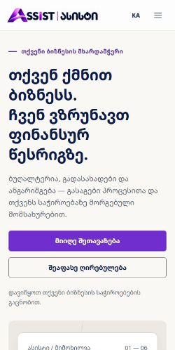
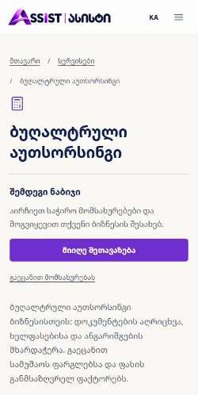
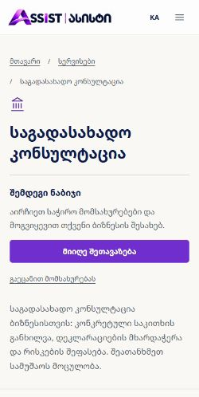
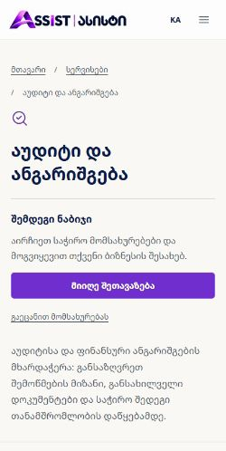

# SEO / AI readiness — უშუალო შემოწმება

20.11.2026, Asia/Tbilisi. [ამოცანა, აღმოჩენილი საკითხები და გაშვების ჩეკლისტი](../../../SEO_AI_READINESS.md).

აპლიკაციის კოდი: `f5008ad8c1d1628f4e5c0eab7a0ea6a9bcdc7087`, განშტოება `codex/assist-seo-multilingual-staging`; საწყისი main `f8e4b3f7964a25216f3305ccccd34c92ca6eb86a`. ამ commit-სა და შემოწმებულ აპლიკაციის ფაილებს შორის git diff ცარიელია. აპლიკაცია აიწყო code commit-ის უშუალოდ წინ; release manifest შემდგომ ამავე კოდის commit-ზე ხელახლა დაიწერა. დოკუმენტაციის დაუკომიტებელი ფაილები manifest-ში პატიოსნად `dirty=true`-ს იძლევა. საბოლოო დოკუმენტაციის commit აპლიკაციას არ ცვლის. clean release audit-ად არ ჩაითვალოს.

გარემო: Windows, Node 26.13.1, Vite 8.3.8, Express production build. საჯარო საიტი მხოლოდ GET მოთხოვნებით შემოწმდა; საჯარო write/deployment/ინდექსაციის ცვლილება ნულია. ყველა რეალურ preview-ზე `INTAKE_MODE=disabled`; არსებული ავტომატური ტესტების სპეციალური API fixtures იყენებს იზოლირებულ დროებით საცავს და საჯარო სისტემას არ ეხება.

ჩაბარებისას preview ხელმისაწვდომია მხოლოდ **http://127.0.0.1:5017/**-ზე. ინდექსაციის სიმულაციის5018 პროცესი შემოწმების შემდეგ შეჩერდა. [საჯარო საბოლოო GET შემოწმება](public-final-gate.json) კვლავ ადასტურებს noindex-ს, ცარიელ site-origin/canonical-სა და sitemap503-ს.

| შემოწმება | შედეგი / მტკიცებულება |
| --- | --- |
| `npm run check` | წარმატებული |
| `npm test` | 44/44, fail 0 |
| `npm run build` | წარმატებული: 45 ენობრივი გვერდი + 3 ენობრივი 404 |
| HTTP preview 5017 | [45 გვერდი / 84 შიდა ბმული](staging-http.json), საკუთარი canonical, lang, ერთი H1, hreflang, JSON-LD, nonce/CSP, noindex/intake disabled; sitemap503 |
| HTTP მხოლოდ loopback ინდექსაციის სიმულაცია 5018 | [45 გვერდი / 84 ბმული](index-simulation-http.json), sitemap200/30კანონიკური URL; editorial გვერდები index, workflow/contact/team/career/query noindex |
| არსებული `audit-web.ts --indexing` | [სრული declared initial assets](http-budget.json): JS359,517 B raw /107,639 B gzip; CSS11,146 B gzip. ყველა budget, compression, cache, favicon და15KA route გადის. |
| ახალი HTTP აუდიტი | თითო ენაში home+3priority initial HTML-ის ხილული აღწერა, scope/FAQ/source date, schema; 4 redirect; 4 unknown404; noindex query/canonical; შეუცვლელი GPTBot პოლიტიკა |
| Native Chrome157 | EN accounting390×844: რეალური ინგლისური ტექსტი, სრული ლოგო, ფერები/CTA, prefixed href-ები; Console0 შეტყობინება. შემდეგ ფანჯარა მინიმიზებული გახდა და UI guard-მა მართვა შეზღუდა. დარჩენილი KA/RU კლიკები/მთლიანი გზა/ენის query+hash ცვლილება ახალი ბრაუზერული შემოწმებით დასასრულებელია. |
| GitHub CI | არ გაშვებულა. ცვლილებები ლოკალურ განშტოებაზეა; არც push და არც PR შექმნილა. |

## ახალი მობილური Lighthouse

Lighthouse **13.6.0**, HeadlessChrome **157.0.0.0**, 412×823 CSS px, DPR1.75, სტანდარტული mobile simulated throttling; სრული პარამეტრები JSON-შია. საწყისი localhost5016 baseline mainf8; საბოლოო localhost5017 იგივე profile. ცალკე5018 სიმულაციის home კი მხოლოდ ინდექსაციის კარიბჭის გავლენას გამოყოფს. ყველა ეს გარემო მხოლოდ loopback-ია.

| გვერდი | Performance ადრე → ბოლოს | LCP ადრე → ბოლოს | TBT ადრე → ბოლოს | გამოუყენებელი JS ადრე → ბოლოს |
| --- | --- | --- | --- | --- |
| მთავარი | 100 → 100 | 1.053 → 0.993 წმ | 23.5 → 35 მწმ | 24,982 → 21,388 B |
| ბუღალტერია | 100 → 100 | 1.056 → 1.028 წმ | 21.5 → 21.5 მწმ | 51,772 → 21,501 B |
| გადასახადები | — → 100 | — → 1.053 წმ | — → 47 მწმ | — → 21,503 B |
| აუდიტი | — → 100 | — → 0.977 წმ | — → 8.5 მწმ | — → 21,503 B |

ბუღალტერიაზე ანიმაციის ლოდის მოხსნა ამცირებს ზედმეტ JS-ს დაახლოებით58%-ით; ქსელში გადატანილი ჯამური რესურსიც632,604→576,349 B-მდე მცირდება (ზუსტი საბოლოო მნიშვნელობა JSON-შია). მცირე LCP/TBT სხვაობა ერთი გაშვების ცვალებადობაა და სტატისტიკურ გაუმჯობესებად არ უნდა შეფასდეს. უფრო მოცულობითი სასარგებლო ტექსტისა და მეტამონაცემების გამო home-ის გადაცემა ოდნავ გაიზარდა; performance budget დაცულია.

ჩვეულებრივი staging-ის SEO ქულა **69**-ია, რადგან noindex განზრახ რჩება. **იზოლირებული launch simulation home: SEO100/Performance100**. ეს არ ნიშნავს საჯარო ინდექსაციას ან მთლიანი საიტის SEO-ს სრულყოფილებას. სტრუქტურირებული მონაცემების ტესტი არის JSON/HTTP/ხილულ ფაქტებთან შესაბამისობის შემოწმება; Google-ის გარე Rich Results Test/Search Console ამ ამოცანაში არ გამოყენებულა.

მტკიცებულებები: [baseline](baseline-summary.json), [საბოლოო ოთხი გვერდი](final-summary.json), [მხოლოდ ლოკალური index simulation](index-simulation-summary.json), [საჯარო HTTP baseline](public-baseline.json), [შეჯამებული QA](result.json). სრული Lighthouse JSON-ები ინახება იგნორირებულ `.artifacts/seo-2026-11-20/` საქაღალდეში.

## რეალური mobile audit კადრები

ქვემოთ მოცემული სურათები **Lighthouse-ის რეალურ headless Chrome რენდერს** წარმოადგენს (final-screenshot audit); არა გენერირებულ მაკეტს და არა ხელით შესრულებულ მრავალმოწყობილობიან მიღებას. წყაროს URL/დრო/viewport [შედეგის JSON-ში](result.json) არის. Chrome-ის ჩარჩო/UI არ არის გადატანილი.

| მთავარი მანამდე | მთავარი შემდეგ |
| --- | --- |
|  |  |

| ბუღალტერია | გადასახადები | აუდიტი |
| --- | --- | --- |
|  |  |  |

## ღიად დარჩენილი

- Native-browser KA/EN/RU სრული გადასვლები, ენის არჩევის query/hash შენარჩუნება და ძირითადი მოთხოვნის გზის საბოლოო ხელით გავლა. HTTP/unit ტესტი ამის შემცვლელი არ არის.
- იურიდიული/ბიზნესის/HR ძველი ვრცელი ტექსტების სარედაქციო/წყაროების შემოწმება სრული30URL ინდექსაციის წინ.
- კოდის გამოქვეყნების, შემდეგ წარმოების ინდექსაციის ჩართვის და Search Console sitemap submission-ის **ცალკე** თანხმობები.
- ჰოსტინგის Git build identity; no physical devices/AT, no field Core Web Vitals, no actual Google/OAI crawl observation.
- MasterPNG უცვლელია (SHA256 `449ff8c94c993a29bc58f9e0e43bb04d594088e367eeb015fd094fbd73191a5e`), პალიტრა A/ქართული სლოგანი/ფორმის ლოგიკა უცვლელია.
